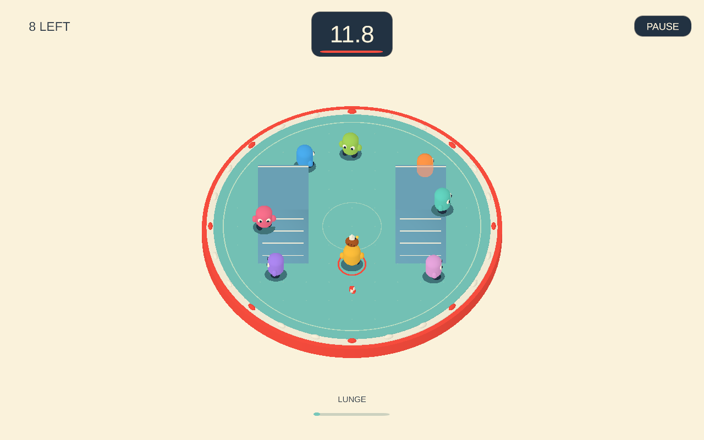

# Hot Potato Tag

A local Unity prototype with directional tag lunges, charged ballistic throws, jumping, and two raised decks. Play a two-character duel to practice, or a 6/8/10/12-character match against bots.

## Play

Open Unity **6000.6.6f1**, open **Assets/Scenes/HotPotato.unity**, and press **Play**. Select a player count and press Play in the lobby. The scene builds its arena, characters, interface, and audio at runtime. The original SampleScene also starts the game.

**Controls have changed: Space jumps; Shift lunges.**

| Action | Keyboard / mouse | Touch | Controller |
| --- | --- | --- | --- |
| Move | WASD / arrows | Drag on the left 44% | Left stick |
| Aim | Mouse pointer; movement/facing if no pointer aim | Tap position, or quick swipe direction on the right | Right stick |
| Lunge | Shift or quick left click/swipe | Quick tap/swipe on right | West button (X on Xbox) |
| Throw | Hold left mouse or E, aim, release | Hold on right, aim, release | Hold right shoulder, release |
| Jump | Space | Jump button | South button (A on Xbox) |
| Pause / resume | Escape / P | Pause button | Start |
| Start / replay | Enter or Play button | Play button | South button |
| Restart immediately | R | Pause, Lobby, Play | Use lobby UI |
| Sound | M or lobby Sound button | Lobby Sound button | Lobby UI |

You are yellow, with a white diamond overhead.

## Passing and throwing

- Ordinary contact does **not** pass the bomb. Land an intentional lunge in your chosen direction. Lunges never lock onto another character.
- After a successful pass, the sender gets a 0.35-second movement boost and **1.15 seconds of return protection**, shown by a white ring. The recipient can pass to other eligible players after a brief 0.18-second receipt lock.
- Receiving a bomb disarms an existing lunge. You must perform a fresh action to pass it.
- Lunges and throws share a 1.05-second cooldown. Missed lunges have a short recovery period.
- A primary press shorter than 0.22 seconds lunges. Longer presses throw on release; charge reaches its maximum at 0.95 seconds.
- Short throws descend quickly; charged throws travel farther in a higher arc. The dotted preview shows the initial flight and first surface contact, not subsequent bounces. Throws do not home in.
- Bomb flight runs 20% faster than the original tuning, preserving the initial arc and range with separate projectile gravity. Charge timing and player jump gravity are unchanged.
- Hitting another eligible character transfers responsibility. Misses bounce and settle into a pickup. The thrower can retrieve a missed throw.
- **The thrower remains responsible until someone else receives the bomb.** If its fuse expires in flight or on the floor, the thrower is eliminated. The loose bomb's ground ring uses the responsible character's color.
- Passing, throwing, and catching never reset the fuse. Rounds start at 12 seconds, shrink by 17%, and stop shrinking at 3 seconds.

## Vertical movement

Two 1.25-unit decks have broad ramps facing the camera. Walk up the ramps, jump onto a deck, or drop from an edge. Platform sides block movement and throws. Jumping can evade low throws and ground lunges, but a character in the air can still be hit at the appropriate height.

Jumps include a small input buffer and grace period after stepping off a ledge. Air steering is weaker than grounded steering. Ground shadows show landing positions; silhouettes keep characters visible behind decks.

Bots use the same jump physics, lunge and throw cooldowns, return protection, and collision rules. They steer toward ramps, jump away from danger, and commit to throw predictions. They are scripted bots, not trained agents.

An experimental ML-Agents 4.1 duel training setup and optional model-driven bots are available. See [Training/README.md](Training/README.md) for setup, PPO runs, model evaluation, and difficulty model slots. The default gameplay bots remain scripted.

## Tuning and code

Select the Hot Potato Tag scene object to tune movement speed, acceleration, dash speed, cooldown, and player count.

- **HotPotatoGame.cs**: match stages, movement, bot decisions, intentional tags, projectile simulation.
- **MatchRules.cs**: fuse, responsibility, per-player immunity, possession, elimination and winner.
- **ArenaGeometry.cs**: shared terrain heights, gravity, ballistic launch and trajectory math.
- **PotatoInput.cs**: input, tap/hold distinction, canceled gestures, multitouch.
- **PotatoActor.cs**: character animation, height-aware shadows and immunity rings.
- **PotatoView.cs**: arena, ramps, projectile preview, silhouettes, camera and pooled feedback.
- **PotatoHud.cs**: minimal HUD and signed-distance-field text.
- **Editor/PotatoChecks.cs**: rule and runtime regressions.

The project includes a trimmed TextMesh Pro resource set: Liberation Sans and its dynamic fallback, the font license, text settings/line-breaking/style resources, and the Mobile Distance Field shader with its required include. Unused HDRP/URP shader graphs, bitmap/sprite/surface/SpaceWarp variants, and example material presets are omitted. The font license is in Assets/TextMesh Pro/Fonts. The HUD renders as a screen overlay using SDF text.

## Checks

Use **Tools > Hot Potato > Validate Match Rules** for engine-independent rule checks. To run runtime checks in an isolated project copy:

~~~powershell
powershell -NoProfile -ExecutionPolicy Bypass -File Tools/Run-HotPotatoChecks.ps1
~~~

The helper copies the project under Temp/HotPotatoChecks, accesses Unity's local licensing service, and leaves your open editor alone. It produces a log, HotPotato-smoke.txt, and lobby/gameplay/throw-preview images.

Checks cover ordinary contact, directional lunges, return protection including chain passes, ballistic hits, airborne evasion, missed-ball recovery, jumps, ramps, walls, drops, keyboard charge/release, projectile pausing, synthetic multitouch and canceled gestures, full matches, arena containment, and rematches.

The parameters are an initial playtest baseline. Automated checks do not establish touch comfort, controller feel, or device frame rates; those still need physical testing. Network multiplayer, larger-match training, and calibrated learned difficulty levels are future work.
